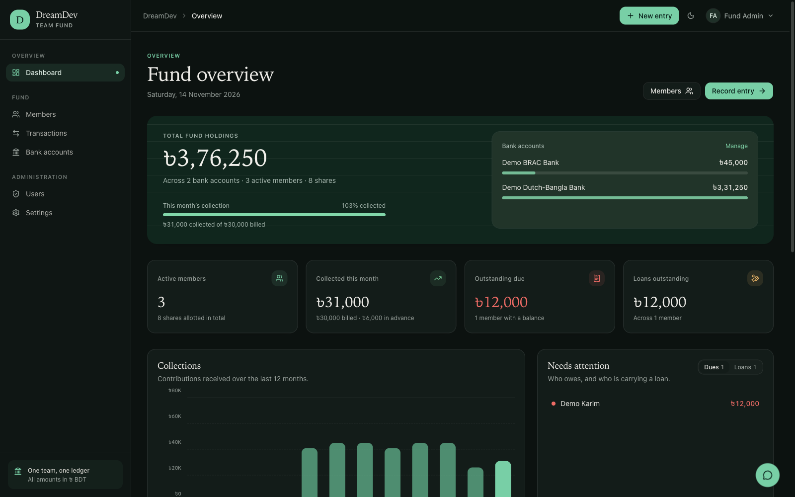
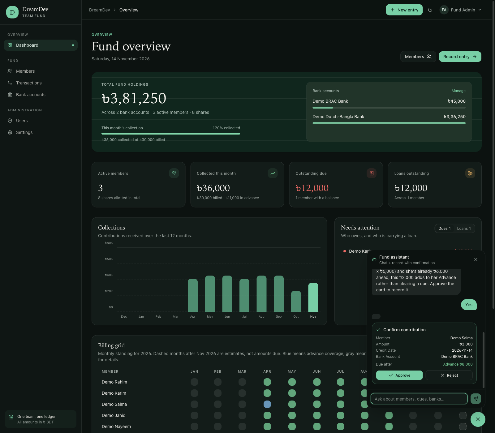
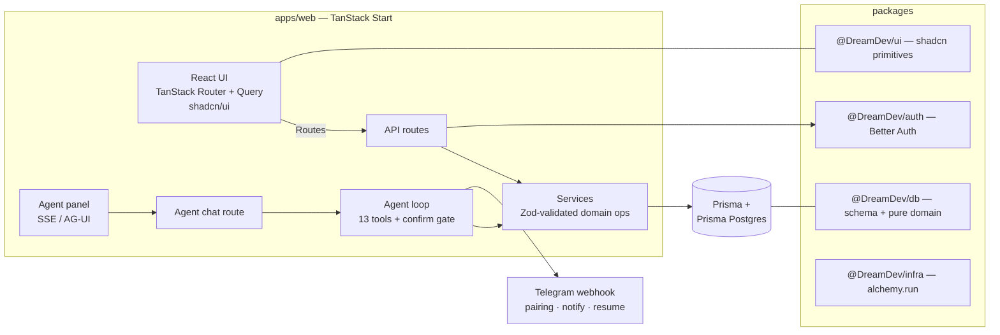

# DreamDev — Team Fund

**Every taka, accounted for.** DreamDev is a joint-savings fund for a single team: members commit to monthly Shares, money lives in the team's bank accounts, and anyone can take an interest-free loan. A running-balance ledger keeps dues, advances, and repayments honest — and an AI assistant operates the whole fund from the dashboard *and* Telegram, with every write gated behind human approval.

[](LICENSE)

| | |
|---|---|
|  |  |
| *The dashboard: holdings, KPIs, dues* | *The assistant previews a write, then waits for approval* |

More: [login](docs/screenshots/login.png) · [member detail](docs/screenshots/member-detail.png) · [transactions ledger](docs/screenshots/transactions.png) · [Telegram pairing](docs/screenshots/settings-telegram.png) · [assistant panel](docs/screenshots/agent-panel.png)

> A personal project — built end-to-end (spec → tickets → implementation → live acceptance) with AI agents under my direction. More on that in [How this was built](#how-this-was-built).

## What it does

**The fund ledger**

- **Members & shares** — each member holds a share quantity; the global Share Price is effective-dated, so a price change never re-bills past months.
- **Contributions & dues** — billing is share × price per month from joining to exit. Each member has one running number: **Due** (billed + adjustments − contributed). A negative Due is an **Advance**, carried forward. No payment allocation, no month-by-month juggling — see [ADR-0001](docs/adr/0001-running-balance-dues.md).
- **Typed ledger** — contributions, loans, repayments, expenses, transfers, and adjustments each get their own table; there is no polymorphic transactions blob ([ADR-0002](docs/adr/0002-typed-ledger-tables.md)). All money is integer taka; all dates are date-only *Credit Dates* on the Asia/Dhaka clock and can never be in the future.
- **Bank accounts** — balances are always derived (opening + in − out across all six entry types), never stored, so they can't drift.
- **Loans** — interest-free, with repayments and per-member outstanding balance; repayments are individually deletable with full audit trail.
- **One activity feed** — every entry in one filterable ledger, with fully optimistic UI: creates insert temp rows, edits/deletes patch caches, dialogs close instantly, toasts carry the outcome.

**Access & roles** — email/password auth (Better Auth). The first user ever to sign up becomes Admin; everyone after is an Editor (fund data only). Admins manage users, share price, and adjustments; deactivated users can't open sessions.

## The AI assistant

The same services the dashboard calls are exposed to an LLM agent as tools — so Zod validation and role guards apply unchanged ([ADR-0004](docs/adr/0004-agent-tools-over-services.md)).

- **Ask anything read-only**: member directory and positions, fund overview KPIs, bank balances, loans and outstanding, a filtered feed search.
- **Record by conversation**: contributions, loans and repayments, expenses, transfers, adjustments — plus edits and soft deletes.
- **Confirm gate on every write.** A write never happens because the model *said* it should. The flow is always: the agent calls a **preview tool** (shows the exact record and the member's Due before → after) → it calls the gated write tool → the run **interrupts** → a confirm card renders from the preview's structured result (never from model prose) → the human clicks **Approve** or **Reject**. A server-side middleware additionally hard-blocks any write whose exact arguments were not previewed earlier in the same thread.
- **Audited**: every conversation, message, and tool call is persisted. Rate-limited per user.
- **Telegram, two ways** — pair a chat with a **User** for the full agent over Telegram (approval pauses persist server-side with a 10-minute TTL and resume from an inline ✅/✖ keyboard), or pair a **Member** to receive templated DMs on 12 fund events (contribution recorded, loan deleted, shares changed, …), deduplicated per record/event/member.

The agent streams over SSE using [TanStack AI](https://ai.tanstack.com) and the AG-UI wire protocol, against any OpenAI-compatible endpoint (model set via `AGENT_MODEL`). The UI renders live reasoning and tool activity with interrupt/resume support.

## Architecture



- **`apps/web`** — fullstack TanStack Start app: routes, API routes, services, the agent, and the Telegram integration.
- **`packages/db`** — multi-file Prisma schema plus pure, heavily-tested domain functions (`due`, `billing`, `balance`, `money`, `month`, `projection`) shared by the dashboard, the agent, and Telegram alike.
- **`packages/auth`**, **`packages/ui`**, **`packages/config`**, **`packages/infra`** — auth wiring, shared shadcn/ui primitives, shared tsconfig, and infra-as-code (alchemy.run: Axiom observability credentials injected per stage).

## How this was built

This repo is also a study in directing AI agents through real product work. Every feature started as a written spec, decomposed into tickets on GitHub Issues, implemented by agent-driven rounds, and then accepted (or bounced) in live usage against a deployed preview — several live rounds caught real bugs that tests missed.

- [`docs/superpowers/specs/`](docs/superpowers/specs/) — the design specs (v1 fund ledger, v2 AI agent + Telegram, date validation + agent repayments)
- [`docs/superpowers/plans/`](docs/superpowers/plans/) — the corresponding implementation plans
- [`docs/adr/`](docs/adr/) — four architecture decision records
- [`GLOSSARY.md`](GLOSSARY.md) — the settled domain vocabulary
- [`AGENTS.md`](AGENTS.md) — how agents work in this repo (issue tracker, triage labels, docs layout)

## Running locally

Prerequisites: [Bun](https://bun.sh), and a **[Prisma Postgres](https://www.prisma.io/postgres)** database URL. (The app talks to Postgres through the `@prisma/adapter-ppg` driver adapter, which expects a Prisma Postgres endpoint — a plain local `postgres` server won't answer the adapter's protocol. The free Prisma Postgres tier works fine for development.)

```bash
bun install          # also generates typed env code via varlock (postinstall)
bun run db:generate  # generate the Prisma client
bun run db:push      # apply the schema to your database
bun run db:seed      # five demo members, two banks, ~8 months of history (refuses a non-empty DB)
bun run dev          # http://localhost:3001
```

Configure `apps/web/.env` (schemas are committed as `.env.schema` and documented inline):

| Variable | Purpose |
|---|---|
| `DATABASE_URL` | Prisma Postgres connection string |
| `BETTER_AUTH_SECRET`, `BETTER_AUTH_URL` | auth secret and canonical origin (`http://localhost:3001` locally) |
| `AGENT_API_KEY`, `AGENT_BASE_URL`, `AGENT_MODEL` | any OpenAI-compatible endpoint for the assistant |
| `TELEGRAM_BOT_TOKEN`, `TELEGRAM_BOT_USERNAME`, `TELEGRAM_WEBHOOK_SECRET` | the Telegram bot |
| `BLOB_READ_WRITE_TOKEN` | Vercel Blob, for member photos ([ADR-0003](docs/adr/0003-vercel-blob-photo-storage.md)) |

The first account you create becomes the Admin. `bun run dev` uses the Vite dev server; for agent SSE streams, verify against the built app (`bun run build && bun run serve`) — the dev proxy is unkind to long-lived streams.

## Tests

```bash
bun test            # ~200 tests across apps/web and packages/db
cd apps/web && bun run test:component   # React Testing Library component tests (jsdom)
```

Domain logic is pure and unit-tested; API services are tested at the HTTP level; the agent loop (including the preview gate and approval interrupts), Telegram pairing/notify, and the seed all have dedicated suites. DB-backed tests derive a `*_test` database from `DATABASE_URL` and truncate between cases. Component tests use React Testing Library on `bun:test`. Default `bun test` discovery excludes `*.test.tsx` via `pathIgnorePatterns` in both `bunfig.toml` files; the `test:component` script overrides that exclusion and loads the jsdom preload in `apps/web/src/test/setup.ts`. No global preload or environment change affects other suites.

## Deployment

The web app deploys to Vercel (`vercel.json`, `bun run deploy:prod`); observability credentials are provisioned as code in `packages/infra` via [alchemy.run](https://alchemy.run) and injected per stage. The Telegram webhook is registered with `scripts/telegram-set-webhook.ts`.

## Security

The fund ledger holds real names, mobile numbers and money movements, so the app ships three named defences plus a data-hygiene posture:

- **XSS — Content-Security-Policy** on every response: `default-src 'self'`, no foreign script origins at all, `object-src 'none'`, `base-uri 'self'`, `form-action 'self'`; images are restricted to the app and the member-photo blob host. `script-src` keeps `'unsafe-inline'` because SSR hydration scripts are request-dynamic (the framework has no per-request nonce API yet). Note that `'unsafe-inline'` permits inline scripts and event handlers, so blocking external script origins does not prevent those injection forms — this CSP is a defence-in-depth layer, not a complete XSS fix.
- **CSRF — layered**: session cookies are `SameSite=Lax` + `httpOnly` (better-auth defaults), auth endpoints validate `trustedOrigins`, and every mutating `/api` request is refused 403 on a foreign `Origin` or `Sec-Fetch-Site: cross-site` (the Telegram webhook is exempt — it authenticates by secret header, not cookie).
- **Clickjacking — `frame-ancestors 'none'` + `X-Frame-Options: DENY`**: no other site may embed the app. `Referrer-Policy: strict-origin-when-cross-origin` and `Permissions-Policy` (camera/microphone/geolocation off) round it out.

**Where member data lives — and where it never does:**

- **Never in localStorage** — the app stores nothing in `localStorage`/`sessionStorage`; the session token lives only in an `httpOnly` cookie JavaScript cannot read.
- **Never in logs** — structured request logs carry method, path, status and the acting user (emails masked); request bodies, ledger records and agent-chat content are never logged. Agent conversations exist only in the app's own audit tables.
- **Never in URLs** — nothing sensitive is passed via query strings; identifiers in paths are opaque UUIDs, and every mutation travels in a request body over the same-origin API.

The idle session ends itself: after 15 minutes without input a 90-second warning counts down, then every open tab is signed out (multi-tab aware via `BroadcastChannel`).

## License

[MIT](LICENSE) — © 2026 shakibdshy. Demo data in screenshots is seeded fiction.
